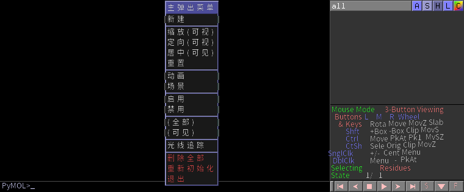
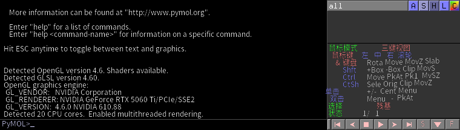

# PyMOL 中文版 · PyMOL Open-Source with a Full Chinese UI

[](LICENSE)
[](https://www.python.org/)
[](#build-from-source)

> **Based on PyMOL(TM).** PyMOL is a trademark of Schrödinger, LLC. This
> project is an independent fork of the
> [Open-Source PyMOL](https://github.com/schrodinger/pymol-open-source)
> distribution and is not affiliated with, endorsed by, or sponsored by
> Schrödinger, LLC.

**English** · [简体中文](README.zh-CN.md)

A fork of Open-Source PyMOL 3.2.0a whose **entire desktop interface can be
displayed in Simplified Chinese**: the Qt menu bar, toolbars, docks, dialogs
and tooltips, the right-click menu, the **C++ internal GUI popup menus**, and
the **OpenGL status HUD**.

| Internal GUI popup menu (C++) | OpenGL HUD |
| --- | --- |
|  |  |

---

## Table of contents

- [Why this fork](#why-this-fork)
- [What upstream PyMOL does](#what-upstream-pymol-does)
- [What this fork adds](#what-this-fork-adds)
- [Installation](#installation)
- [Language switching](#language-switching)
- [Screenshots of the Chinese UI](#screenshots-of-the-chinese-ui)
- [Build from source](#build-from-source)
- [How the translation system works](#how-the-translation-system-works)
- [Adding a language](#adding-a-language)
- [Verification](#verification)
- [Roadmap / limitations](#roadmap--limitations)
- [License and attribution](#license-and-attribution)
- [Contributing](#contributing)

---

## Why this fork

PyMOL is one of the most widely used molecular visualization tools, and it is
used by a large number of students and researchers whose first language is
Chinese. Upstream PyMOL has no localization layer at all: every string is a
literal in Python or C++, and the OpenGL "internal GUI" is painted with an
ASCII bitmap font, so Chinese text cannot be displayed even in principle.

This fork adds a complete, catalog-driven internationalization (i18n) system
and makes the whole desktop interface available in Simplified Chinese, without
changing any scientific behaviour. English remains the default whenever no
Chinese locale is available, so the program behaves exactly like upstream on
non-Chinese systems.

## What upstream PyMOL does

Open-Source PyMOL is a Python-enhanced molecular graphics system. The core
capabilities are unchanged in this fork:

**Visualization**

- Representations: cartoon, ribbon, sticks, ball-and-stick, spheres, lines,
  dots, non-bonded, wireframe, licorice, ellipsoids, surface, mesh, volume,
  isosurface, slice, CGO and measurement objects.
- Cameras, stereo (cross-eye, wall-eye, quad-buffered), shaders, shadows,
  ambient occlusion and a built-in ray tracer; POV-Ray scene export.

**Molecular editing**

- Builder for proteins, nucleic acids and small fragments; residue/fragment
  attachment; mutagenesis; sculpting; bond, valence and charge editing;
  hydrogen addition/removal; atom and object dragging.

**Analysis and measurement**

- Distances, angles, dihedrals, areas and volumes; hydrogen bonds and polar
  contacts; cavity detection; electrostatics (APBS) and potential maps;
  density maps (CCP4/MRC) and volumes; sequence alignment (CEalign).

**Animation and presentation**

- Movies, scenes, states, camera motion, movie panel, MPEG and PNG-sequence
  export.

**File formats**

- Import: PDB, mmCIF, MMTF, mol2, SDF, MAE, CCP4/MRC/DX maps, sessions
  (`.pse`), trajectories (netCDF, MMTF).
- Export: PNG, POV, VRML, COLLADA, GLB/glTF, STL, USDA/USDZ, MPEG.

**Scripting**

- The `pymol.cmd` command API and the `pymol2.PyMOL` headless API; plugins,
  wizards, selections, groups, scenes and undo.

> See [`docs/PROJECT-ANALYSIS.md`](docs/PROJECT-ANALYSIS.md) for a full
> structural analysis (layered C++ architecture, Python modules, build system,
> dependencies and licensing).

## What this fork adds

### 1. A complete translation layer

- `modules/pymol/i18n.py` — a pure-standard-library translator
  (no build required, importable standalone, unit tested).
- `data/i18n/en.json` (source language / key registry) and
  `data/i18n/zh_CN.json` (**~940 Simplified Chinese strings**).
- Safe fallback chain: **requested language → English → the literal text**.
  A missing translation never breaks the interface.
- Placeholder-safe formatting (`{name}`, `%s`), plural and contextual lookups,
  and a case-insensitive fallback (`zoom` → `Zoom`).

### 2. Language switching everywhere

- **GUI**: `Display → Language → English / 简体中文` — applied live, remembered
  for the next session.
- **Command line**: `pymol --lang zh_CN`.
- **Environment**: `PYMOL_LANG=zh_CN`.
- **PyMOL command**: `lang zh_CN` (or `lang` to list the available languages).
- **Default**: explicit choice → `--lang` → `$PYMOL_LANG` → saved preference →
  OS UI locale → English.

### 3. Chinese in the OpenGL internal GUI

The internal GUI (object list, popup menus, HUD) is painted by C++ with an
ASCII bitmap font. This fork embeds a **Noto Sans SC subset** (7,265
characters, SIL OFL 1.1) and teaches PyMOL's FreeType text path to use it, so
the object list, popup menus and HUD can all render Chinese:

| Component | What was done |
| --- | --- |
| `layer1/FontCJK.h` | Embedded CJK font subset, generated by `tools/gen_font_header.py` |
| `layer1/Text.cpp` | Registers the font, uses it for overlay text, UTF-8 char drawing |
| `layer4/PopUp.cpp` | Popup menus draw per UTF-8 code point (CJK = 2 cells), width in cells |
| `layer1/FontType.cpp` | Vector-font renderer made null-safe and 2D-overlay-aware (**two real bugs fixed**) |
| `layer1/HudTr.h` | Generated HUD translation table (`TextTr()`), UTF-8 byte-escaped |

### 4. Right-click menu

The right-click "Main Pop-Up" is rendered by native **Qt** menus
(`modules/pmg_qt/qt_context_menu.py`), so it follows the selected language and
uses system fonts. Toggle it with `qt_context_menu 0` / `qt_context_menu 1`.

### 5. Build and release automation

- `scripts/build_windows.ps1` — one-command Windows build (MSVC + Miniforge).
- `.github/workflows/build-wheel.yml` — CI that builds a wheel on
  Windows/Linux/macOS and runs a smoke test.
- `tools/i18n_lint.py`, `tools/i18n_extract.py`, `tools/gen_font_header.py`,
  `tools/gen_hud_header.py` — the translation toolchain.
- `docs/I18N.md`, `docs/RELEASE.md`, `NOTICE`, `THIRD-PARTY-NOTICES.md`,
  `CONTRIBUTING.md` — documentation and release checklist.

## Installation

### Portable bundle (Windows x64, no Python needed)

A self-contained folder is provided in `pymol安装包/`:

```
pymol安装包/
├─ 启动PyMOL.bat        # double-click to launch
├─ start_pymol.bat
├─ python/              # embedded Python + PyMOL + Qt
└─ README.md
```

Copy the **whole folder** to any location (USB stick, another PC) and
double-click `启动PyMOL.bat`. Nothing needs to be installed.

### From a wheel

```bash
pip install dist/pymol-3.2.0a0-cp312-cp312-win_amd64.whl
# optional GUI dependencies
pip install PySide6-Essentials numpy
pymol
```

## Language switching

```bash
pymol --lang zh_CN          # start in Chinese
PYMOL_LANG=zh_CN pymol      # same, via the environment
```

Inside PyMOL:

```
lang                 # list available languages
lang zh_CN           # switch to Simplified Chinese (remembered)
lang en              # back to English
```

Or use the GUI: **Display → Language → 简体中文**.

When switching to a language, the Qt UI, the right-click menu, the C++
internal GUI popup menus **and** the HUD all update immediately.

## Screenshots of the Chinese UI

| Element | Screenshot |
| --- | --- |
| Internal GUI popup menu (C++, object row buttons) | [`docs/images/internal-gui-chinese-popup.png`](docs/images/internal-gui-chinese-popup.png) |
| OpenGL HUD (mouse mode / picking / state) | [`docs/images/internal-gui-chinese-hud.png`](docs/images/internal-gui-chinese-hud.png) |

## Build from source

Requirements: a C++17 compiler, CMake ≥ 3.13, Python ≥ 3.9, and the native
dependencies (freetype, GLEW, libpng; optionally glm, msgpack-c, mmtf-cpp,
libxml2, netcdf).

**Windows (one command, needs Visual Studio C++ Build Tools):**

```powershell
.\scripts\build_windows.ps1
```

**Linux / macOS:**

```bash
pip install --upgrade pip setuptools cmake numpy
pip wheel --no-build-isolation --no-deps \
  --config-settings testing=False --config-settings json=False \
  --config-settings use-msgpackc=no --config-settings libxml=no \
  -w dist .
```

Upstream build instructions are in [`INSTALL`](INSTALL); the CI matrix in
[`.github/workflows/build.yml`](.github/workflows/build.yml) shows the exact
dependency sets used on each platform.

## How the translation system works

```
modules/pymol/i18n.py            core translator (stdlib only, standalone)
modules/pmg_qt/i18n_qt.py        Qt widget/action/menu localizer (duck typed)
modules/pmg_qt/qt_context_menu.py Qt-rendered right-click menu
modules/pmg_qt/pymol_gl_widget.py right-click hook
modules/pmg_qt/pymol_qt_gui.py   Qt front end wiring + language menu
modules/pmg_tk/skins/normal/     Tk menubar wiring
modules/pymol/menu.py            C++ popup menu labels
modules/pymol/controlling.py     mouse-mode names
data/i18n/en.json                source language (key registry)
data/i18n/zh_CN.json             Simplified Chinese catalog
layer1/FontCJK.h                 embedded Noto Sans SC subset (OFL)
layer1/HudTr.h                   generated HUD translation table
tools/i18n_lint.py               catalog validation (CI gate)
testing/tests/i18n/              unit tests (no PyMOL build required)
```

Key properties:

- **Catalog-driven**: adding or fixing a translation never requires touching
  C++ (except the HUD table, which is regenerated).
- **Never breaks the UI**: unknown strings fall back to English.
- **Testable without a build**: the core translator and the Qt localizer are
  covered by 43 unit tests that run on a stock CPython.
- **Validated in CI**: `python tools/i18n_lint.py` checks JSON, duplicate keys,
  metadata, placeholder parity and empty values.

## Adding a language

1. Copy `data/i18n/zh_CN.json` to `data/i18n/<code>.json`.
2. Update `meta.language`, `meta.native_name`, `meta.english_name`.
3. Translate the `strings` object (keep `{placeholders}`, `%s` and trailing
   `...` intact).
4. Run `python tools/i18n_lint.py` — it must report `0 error(s)`.
5. (Optional) add aliases to `LANGUAGE_ALIASES` in `modules/pymol/i18n.py`.

See [`docs/I18N.md`](docs/I18N.md) for details.

## Verification

```bash
# catalog validation
python tools/i18n_lint.py                 # -> 0 error(s), 0 warning(s)

# unit tests (no PyMOL build required)
python -m unittest discover -s testing/tests/i18n -p 'test_*.py'   # -> 43 tests OK

# smoke test of the built package
python -c "import pymol2; p=pymol2.PyMOL(); p.start(); p.cmd.fragment('ala'); \
           print('atoms', p.cmd.count_atoms()); p.stop()"
```

The Chinese UI was verified with real screenshots of the running application
(see above) — including the C++ popup menus and the OpenGL HUD.

## Roadmap / limitations

- **Object names are ASCII-only** by PyMOL's own validation, so the object list
  cannot show Chinese names.
- Keyboard abbreviations (`Shift`, `Ctrl`, `CtSh`) and mouse-mode mnemonics
  (`Rota`, `MovZ`, …) intentionally stay English.
- The C++ internal GUI now has a CJK-capable text path; further UI areas can be
  translated by extending the catalog and the HUD table.

## License and attribution

- Copyright (c) Schrödinger, LLC. Published under a **BSD-like license** — see
  [`LICENSE`](LICENSE).
- Attribution and trademark terms: [`NOTICE`](NOTICE).
- Bundled third-party components (including the Noto Sans SC subset under the
  SIL Open Font License 1.1): [`THIRD-PARTY-NOTICES.md`](THIRD-PARTY-NOTICES.md).
- **PyMOL(TM) is a trademark of Schrödinger, LLC.** This project is
  "Based on PyMOL(TM)" and is not affiliated with Schrödinger, LLC.

## Contributing

See [`CONTRIBUTING.md`](CONTRIBUTING.md) and [`DEVELOPERS`](DEVELOPERS).
Translation improvements are very welcome — edit `data/i18n/zh_CN.json`, run
`tools/i18n_lint.py`, and open a pull request.
