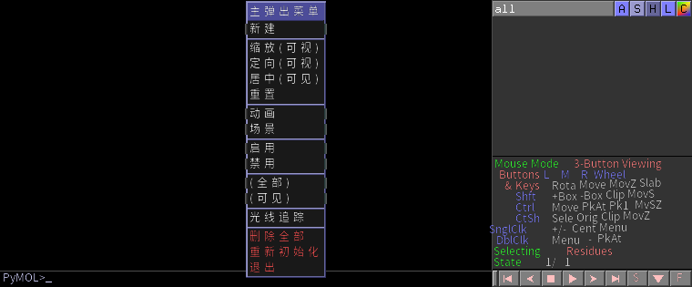
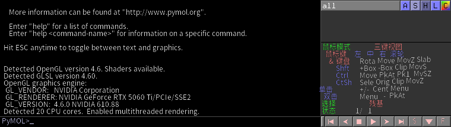

# PyMOL 中文版 · 完整中文界面的 PyMOL

[](LICENSE)
[](https://www.python.org/)
[](#从源码编译)

> **基于 PyMOL(TM)。** PyMOL 是 Schrödinger, LLC 的商标。本项目是
> [Open-Source PyMOL](https://github.com/schrodinger/pymol-open-source)
> 的独立分支（fork），与 Schrödinger, LLC 没有任何隶属、背书或赞助关系。

[English](README.md) · **简体中文**

这是 Open-Source PyMOL 3.2.0a 的分支，**整个桌面界面都可以用简体中文显示**：
Qt 菜单栏、工具栏、停靠面板、对话框与提示，鼠标右键菜单，**C++ 内置 GUI 弹出
菜单**，以及 **OpenGL 状态 HUD（鼠标模式提示）**。

| 内部 GUI 弹出菜单（C++） | OpenGL HUD |
| --- | --- |
|  |  |

---

## 目录

- [为什么做这个分支](#为什么做这个分支)
- [原程序（上游 PyMOL）的功能](#原程序上游-pymol-的功能)
- [本分支新增了什么](#本分支新增了什么)
- [安装](#安装)
- [语言切换](#语言切换)
- [中文界面截图](#中文界面截图)
- [从源码编译](#从源码编译)
- [翻译系统如何工作](#翻译系统如何工作)
- [新增一种语言](#新增一种语言)
- [验证](#验证)
- [路线图与限制](#路线图与限制)
- [许可证与署名](#许可证与署名)
- [参与贡献](#参与贡献)

---

## 为什么做这个分支

PyMOL 是被广泛使用的分子可视化软件，在中文教学与科研环境中用户量很大。但上游
PyMOL **完全没有本地化层**：所有文案都是 Python 或 C++ 里的字面量；而 OpenGL
「内置 GUI」（对象列表、弹出菜单、HUD）是用 **ASCII 点阵字模**绘制的，因此中文
在原理上就无法显示。

本分支新增了一套完整的、以翻译目录（catalog）驱动的国际化（i18n）系统，让整个
桌面界面支持简体中文，且**不改变任何科学计算行为**。在没有中文环境的系统上，
默认语言仍是英文，表现与上游完全一致。

## 原程序（上游 PyMOL）的功能

Open-Source PyMOL 是一个「Python 增强的分子图形系统」。本分支保留了它的全部
能力：

**可视化**

- 表征：卡通（cartoon）、带状（ribbon）、棒状（sticks）、球棍、球状、线状、
  点状、非键、线框、甘草（licorice）、椭球、表面、网格、体积、等值面、切片、
  CGO 与测量对象。
- 相机、立体显示（交叉眼/墙眼/四缓冲）、着色器、阴影、环境光遮蔽、内置光线
  追踪，以及 POV-Ray 场景导出。

**分子编辑**

- 蛋白质、核酸与小分子片段的建模（Builder）；残基/片段拼接；突变；雕刻
  （sculpting）；键、价态与电荷编辑；加氢/去氢；原子与对象拖动。

**分析与测量**

- 距离、角度、二面角、面积与体积；氢键与极性接触；空腔检测；静电势（APBS）与
  势能图；密度图（CCP4/MRC）与体积；序列比对（CEalign）。

**动画与演示**

- 动画（movie）、场景（scene）、状态（state）、相机运动、动画面板、MPEG 与
  PNG 序列导出。

**文件格式**

- 导入：PDB、mmCIF、MMTF、mol2、SDF、MAE、CCP4/MRC/DX 密度图、会话文件
  （`.pse`）、轨迹（netCDF、MMTF）。
- 导出：PNG、POV、VRML、COLLADA、GLB/glTF、STL、USDA/USDZ、MPEG。

**脚本能力**

- `pymol.cmd` 命令 API 与 `pymol2.PyMOL` 无界面 API；插件、向导、选择集、
  分组、场景与撤销。

> 完整的结构分析（C++ 分层架构、Python 模块、构建系统、依赖与许可证）见
> [`docs/PROJECT-ANALYSIS.md`](docs/PROJECT-ANALYSIS.md)。

## 本分支新增了什么

### 1. 完整的翻译层

- `modules/pymol/i18n.py` —— 纯标准库实现的翻译器（无需编译、可独立导入、
  有单元测试覆盖）。
- `data/i18n/en.json`（源语言 / 键注册表）与 `data/i18n/zh_CN.json`
  （**约 940 条简体中文文案**）。
- 安全的回退链：**目标语言 → 英文 → 原文**。缺译不会破坏界面。
- 占位符安全格式化（`{name}`、`%s`）、复数与上下文查询，以及大小写回退
  （`zoom` → `Zoom`）。

### 2. 随处可用的语言切换

- **图形界面**：`显示 → 语言 → English / 简体中文`，**即时生效**并记住选择。
- **命令行**：`pymol --lang zh_CN`。
- **环境变量**：`PYMOL_LANG=zh_CN`。
- **PyMOL 命令**：`lang zh_CN`（`lang` 列出可用语言）。
- **默认语言**：显式选择 → `--lang` → `$PYMOL_LANG` → 已存偏好 → 系统语言 →
  英文。

### 3. OpenGL 内置 GUI 的中文显示

内置 GUI（对象列表、弹出菜单、HUD）由 C++ 用 ASCII 点阵字模绘制。本分支内嵌
**Noto Sans SC 子集**（7265 字，SIL OFL 1.1 授权），并让 PyMOL 的 FreeType
文字路径使用它，于是对象列表、弹出菜单和 HUD 都能显示中文：

| 组件 | 做了什么 |
| --- | --- |
| `layer1/FontCJK.h` | 内嵌中文字体子集，由 `tools/gen_font_header.py` 生成 |
| `layer1/Text.cpp` | 注册字体、叠加层文字使用该字体、按 UTF-8 字符绘制 |
| `layer4/PopUp.cpp` | 弹出菜单按 UTF-8 码点逐字绘制（CJK 占 2 格），宽度按字符格计算 |
| `layer1/FontType.cpp` | 矢量字体渲染器增加判空与 2D 叠加层支持（**修掉 2 个真实缺陷**） |
| `layer1/HudTr.h` | 生成的 HUD 翻译表（`TextTr()`），以 UTF-8 字节转义写入 |

### 4. 鼠标右键菜单

右键「主弹出菜单」改用原生 **Qt 菜单**渲染
（`modules/pmg_qt/qt_context_menu.py`），跟随语言设置、使用系统字体。
可用 `qt_context_menu 0` / `qt_context_menu 1` 在原生菜单与 Qt 菜单之间切换。

### 5. 构建与发布自动化

- `scripts/build_windows.ps1` —— Windows 一键构建（MSVC + Miniforge）。
- `.github/workflows/build-wheel.yml` —— CI 在 Windows/Linux/macOS 构建 wheel
  并做冒烟测试。
- `tools/i18n_lint.py`、`tools/i18n_extract.py`、`tools/gen_font_header.py`、
  `tools/gen_hud_header.py` —— 翻译工具链。
- `docs/I18N.md`、`docs/RELEASE.md`、`NOTICE`、`THIRD-PARTY-NOTICES.md`、
  `CONTRIBUTING.md` —— 文档与发布清单。

## 安装

### 便携包（Windows x64，无需安装 Python）

`pymol安装包/` 目录是一个自包含的运行环境：

```
pymol安装包/
├─ 启动PyMOL.bat        # 双击启动
├─ start_pymol.bat
├─ python/              # 内嵌 Python + PyMOL + Qt
└─ README.md
```

把**整个目录**复制到任意位置（U 盘、另一台电脑），双击 `启动PyMOL.bat` 即可，
无需安装任何东西。

### 从 wheel 安装

```bash
pip install dist/pymol-3.2.0a0-cp312-cp312-win_amd64.whl
pip install PySide6-Essentials numpy   # 可选：图形界面
pymol
```

## 语言切换

```bash
pymol --lang zh_CN          # 以中文启动
PYMOL_LANG=zh_CN pymol      # 同上，用环境变量
```

在 PyMOL 内：

```
lang                 # 列出可用语言
lang zh_CN           # 切换到简体中文（会记住）
lang en              # 切回英文
```

或使用图形界面：**显示 → 语言 → 简体中文**。

切换语言后，Qt 界面、右键菜单、C++ 内置 GUI 弹出菜单**以及 HUD** 都会立即更新。

## 中文界面截图

| 元素 | 截图 |
| --- | --- |
| 内部 GUI 弹出菜单（C++，对象行按钮） | [`docs/images/internal-gui-chinese-popup.png`](docs/images/internal-gui-chinese-popup.png) |
| OpenGL HUD（鼠标模式 / 拾取 / 状态） | [`docs/images/internal-gui-chinese-hud.png`](docs/images/internal-gui-chinese-hud.png) |

## 从源码编译

需要：C++17 编译器、CMake ≥ 3.13、Python ≥ 3.9，以及原生依赖
（freetype、GLEW、libpng；可选 glm、msgpack-c、mmtf-cpp、libxml2、netcdf）。

**Windows（一条命令，需先安装 Visual Studio C++ 生成工具）：**

```powershell
.\scripts\build_windows.ps1
```

**Linux / macOS：**

```bash
pip install --upgrade pip setuptools cmake numpy
pip wheel --no-build-isolation --no-deps \
  --config-settings testing=False --config-settings json=False \
  --config-settings use-msgpackc=no --config-settings libxml=no \
  -w dist .
```

上游构建说明见 [`INSTALL`](INSTALL)；各平台确切的依赖集合见
[`.github/workflows/build.yml`](.github/workflows/build.yml)。

## 翻译系统如何工作

```
modules/pymol/i18n.py            核心翻译器（纯标准库，可独立使用）
modules/pmg_qt/i18n_qt.py        Qt 控件/动作/菜单本地化（鸭子类型，无需 Qt 即可测）
modules/pmg_qt/qt_context_menu.py Qt 渲染的右键菜单
modules/pmg_qt/pymol_gl_widget.py 右键拦截钩子
modules/pmg_qt/pymol_qt_gui.py   Qt 前端接线 + 语言菜单
modules/pmg_tk/skins/normal/     Tk 菜单栏接线
modules/pymol/menu.py            C++ 弹出菜单标签
modules/pymol/controlling.py     鼠标模式名称
data/i18n/en.json                源语言（键注册表）
data/i18n/zh_CN.json             简体中文翻译目录
layer1/FontCJK.h                 内嵌 Noto Sans SC 子集（OFL）
layer1/HudTr.h                   生成的 HUD 翻译表
tools/i18n_lint.py               目录校验（CI 门禁）
testing/tests/i18n/              单元测试（无需编译 PyMOL）
```

关键特性：

- **目录驱动**：新增或修正翻译不需要改 C++（HUD 表除外，它是自动生成的）。
- **绝不破坏界面**：查不到的文案回退为英文。
- **无需编译即可测试**：核心翻译器与 Qt 本地化器由 43 项单元测试覆盖，
  在普通 CPython 上即可运行。
- **CI 校验**：`python tools/i18n_lint.py` 检查 JSON、重复键、元数据、
  占位符一致性与空译文。

## 新增一种语言

1. 把 `data/i18n/zh_CN.json` 复制为 `data/i18n/<code>.json`；
2. 修改 `meta.language`、`meta.native_name`、`meta.english_name`；
3. 翻译 `strings` 对象（保留 `{占位符}`、`%s` 与结尾的 `...`）；
4. 运行 `python tools/i18n_lint.py`，必须为 `0 error(s)`；
5. （可选）在 `modules/pymol/i18n.py` 的 `LANGUAGE_ALIASES` 中加入别名。

细节见 [`docs/I18N.md`](docs/I18N.md)。

## 验证

```bash
# 翻译目录校验
python tools/i18n_lint.py                 # -> 0 error(s), 0 warning(s)

# 单元测试（无需编译 PyMOL）
python -m unittest discover -s testing/tests/i18n -p 'test_*.py'   # -> 43 tests OK

# 编译产物冒烟测试
python -c "import pymol2; p=pymol2.PyMOL(); p.start(); p.cmd.fragment('ala'); \
           print('atoms', p.cmd.count_atoms()); p.stop()"
```

中文界面已用**运行中程序的真实截图**验证（见上方两张图），包括 C++ 弹出菜单与
OpenGL HUD。

## 路线图与限制

- **对象名只能是 ASCII**（PyMOL 自身的名称校验会剥离非 ASCII 字符），因此对象
  列表里无法显示中文对象名。
- 键盘缩写（`Shift`、`Ctrl`、`CtSh`）与鼠标模式助记符（`Rota`、`MovZ` 等）
  有意保留英文。
- 内置 GUI 的文字路径现已支持 CJK，后续界面区域可以通过扩充翻译目录与 HUD 表
  继续中文化。

## 许可证与署名

- 版权所有 (c) Schrödinger, LLC，以 **BSD 类许可证**发布，见 [`LICENSE`](LICENSE)。
- 署名与商标条款见 [`NOTICE`](NOTICE)。
- 内嵌第三方组件（含 SIL Open Font License 1.1 授权的 Noto Sans SC 子集）见
  [`THIRD-PARTY-NOTICES.md`](THIRD-PARTY-NOTICES.md)。
- **PyMOL(TM) 是 Schrödinger, LLC 的商标。** 本项目「基于 PyMOL(TM)」，
  与 Schrödinger, LLC 无隶属关系。

## 参与贡献

见 [`CONTRIBUTING.md`](CONTRIBUTING.md) 与 [`DEVELOPERS`](DEVELOPERS)。
非常欢迎改进翻译：编辑 `data/i18n/zh_CN.json`，运行 `tools/i18n_lint.py`，
然后提交 PR。
