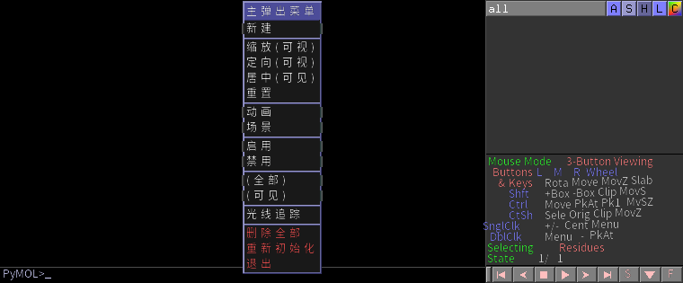

# 把 PyMOL 的整个界面变成中文：从翻译目录到 C++ 字体渲染的完整实践

> 项目地址：`https://github.com/maxcloud/pymol-open-source-zh`（PyMOL 中文版）
> 基于 Open-Source PyMOL 3.2.0a，BSD 类许可证；PyMOL(TM) 是 Schrödinger, LLC 的商标。



## 一、为什么做这件事

PyMOL 是结构生物学里最常用的分子可视化工具之一，中文用户非常多。但它上游
**完全没有本地化层**：所有界面文案都是 Python/C++ 里的字面量；更麻烦的是，
OpenGL 视口里的「内置 GUI」——对象列表、右键弹出菜单、底部的鼠标模式
HUD——是用一张**只有 ASCII 字形**的点阵字模绘制的。

这意味着：即使你把字符串换成中文，屏幕上也会显示成 `??????`。所以这不是一次
「翻译工程」，而是一次「翻译 + 渲染 + 构建」的联合工程。

最终目标是：**整个桌面界面（Qt 界面 + C++ 内置 GUI + HUD）都能显示中文，
并且可以随时中英切换、可以复制到任意电脑上直接运行。**

---

## 二、先把项目摸清楚

动手前先做了结构化分析（结论沉淀在 `docs/PROJECT-ANALYSIS.md`）：

- **规模**：约 1,587 个文件 / 113 万行；C++ 分层 `layer0…layer5` + `ov` +
  `layerGraphics`，Python 应用层 `modules/`（`pymol`、`pmg_qt`、`pmg_tk`、
  `chempy`、`web`）。
- **绑定方式**：CPython 扩展 `_cmd`，由 `setup.py` 的 `CMakeExtension` +
  `_custom_build/backend.py` 驱动 CMake 编译。
- **两套 GUI 并存**：`pmg_qt`（PySide6，现代界面）与 `pmg_tk`（Pmw，旧界面），
  两者共享 `pymol/_gui.py` 的菜单数据；而**右键菜单与对象列表**由 C++
  的 `MenuActivate` + `PopUp` 渲染。
- **关键洞察**：菜单**内容**来自 Python（`pymol/menu.py` 返回
  `[code, 'label', command]` 结构），**渲染**在 C++。这决定了翻译的切入点。

---

## 三、设计：目录驱动的 i18n

没有选择 gettext（`.mo` 需要编译、且 PyMOL 的字符串散落在 Python 与 C++ 两处），
而是设计了一个轻量的、可增量迁移的方案：

```
data/i18n/en.json        源语言（同时是键注册表）
data/i18n/zh_CN.json     简体中文（约 940 条）
modules/pymol/i18n.py    核心翻译器（纯标准库，可独立导入）
```

核心 API 只有一个：

```python
from pymol import i18n
i18n.tr("File")                    # → 文件
i18n.tr("Welcome, {name}", name="Lee")
```

设计要点：

- **键 = 英文原文**。这样未翻译的字符串天然回退为英文，可以**增量迁移**，
  不需要一次性改完整个项目。
- **回退链**：目标语言 → 英文 → 原文。缺译永远不崩。
- **占位符安全**：`{name}`、`%s` 缺失时原样保留。
- **大小写回退**：菜单里是 `zoom`，目录里是 `Zoom`，也能命中。
- **语言解析**：显式选择 → `--lang` → `$PYMOL_LANG` → 已存偏好 → 系统语言 →
  英文。

质量保障用两个工具 + 一套测试：

- `tools/i18n_lint.py`：校验 JSON、重复键、元数据、占位符一致性、空译文；
- `tools/i18n_extract.py`：从源码抽取候选文案，统计覆盖率；
- `testing/tests/i18n/`：43 项单元测试，**不需要编译 PyMOL** 即可运行。

---

## 四、接入点：不要逐个文件改

PyMOL 的界面文案分布在几十个文件里。逐个改既慢又容易漏。我们找到三个「咽喉」：

1. **Qt 菜单栏 / 工具栏 / 对话框**：`pmg_qt/i18n_qt.py` 用鸭子类型遍历 Qt 控件树
   （`text` / `title` / `windowTitle` / `toolTip`），把英文原文存进动态属性，
   切换语言时重放。对话框是**按需创建**的，所以额外挂了一个
   `QEvent.Show` 事件过滤器，任何新窗口第一次显示时自动本地化。
2. **共享菜单数据**：两个 GUI 都用 `pymol/_gui.py` 的菜单结构，一次改动同时覆盖。
3. **C++ 弹出菜单**：交互上改用原生 Qt 菜单（`qt_context_menu.py`）；
   同时保留 C++ 弹出菜单的中文支持（见下一节）。

---

## 五、最硬的骨头：C++ 内置 GUI 的中文渲染

这一节是整个项目里技术含量最高的部分，也是踩坑最多的地方。

### 5.1 底层其实早就支持 UTF-8

读源码发现两个渲染器**都已经**在做 UTF-8 解码：

- `layer1/FontGLUT.cpp` 的 `next_utf8_character()`（点阵字体）
- `layer1/FontType.cpp` 的 `CheckUnicode()`（矢量字体）

也就是说，**缺的不是解码，而是「有中文字形的字体」**。

### 5.2 嵌入一个中文字体

PyMOL 本来就内嵌了十几套字体（`FontTTF.h` 14 MB、`FontTTF2.h` 2.6 MB，
都是 `unsigned char` 字节数组）。于是照同样的模式：

1. `tools/gen_font_header.py` 用 fontTools 把 **Noto Sans SC**（OFL 授权）
   子集化到 7,265 字（ASCII + Latin-1 + 中文标点 + GB2312 全字集 + 翻译目录用字），
   生成 `layer1/FontCJK.h`（9.4 MB 头文件，1.79 MB 字体）。
2. 在 `TextInit()` 里注册为字体 19，并让叠加层文字（`TextDrawStr` /
   `TextDrawStrAt`）使用它。

### 5.3 然后程序崩溃了：`info == nullptr`

第一次编译运行，GL 渲染直接**访问违例**。定位到 `FontType.cpp`：

```cpp
sampling = info->sampling;   // info 可能是 nullptr！
...
if(info->ortho) { ... }
```

矢量字体原本只用于 3D 标签（`RepLabel`，有 `RenderInfo`），而
**2D 叠加层路径传的是 `nullptr`**（点阵字体不需要 `info`）。加两处判空后，
崩溃消失。

> 这是第一个「上游潜在缺陷」：把矢量字体用于叠加层就会踩到。

### 5.4 然后菜单变成了空框：`isworldlabel`

修好崩溃后，右键菜单只剩一排空框。继续读 `FontType.cpp`：

```cpp
cont &= CharacterRenderOpenGL(G, info, id, true, ...);   // 恒为 true
```

这个 `true` 是 `isworldlabel`。为 `true` 时，`CharacterRenderOpenGL` 会把文字
塞进 **3D 标签** 的 CGO 指令（需要 `WorldPos`）；而 2D 叠加层需要的是
「屏幕纹理四边形」（`CGODrawTexture`）。点阵字体的调用点传的是 `false`。

改成按 `rpos` 推导：

```cpp
cont &= CharacterRenderOpenGL(G, info, id, rpos != nullptr, ...);
```

菜单立刻正常显示。

> 这是第二个缺陷：矢量字体被硬编码为「3D 标签」，导致它在 2D 叠加层里不可见。

### 5.5 弹出菜单的 UTF-8 逐字绘制

C++ 弹出菜单原本是**按字节**逐个画的（`TextDrawChar(*(c++))`），固定 8px 步进。
中文是 3 字节，这样画必然错位。改成：

- 按 UTF-8 码点解码；
- CJK 字符按 **2 格宽** 绘制；
- 弹出框宽度也按「字符格」计算（2 格/汉字）。

### 5.6 HUD 也要中文：C++ 里没有 i18n

底部的 `Mouse Mode` / `Buttons` / `Picking` / `Frame` / `State` 等是
`ButMode.cpp` 里**硬编码的 C++ 字面量**，Python 的翻译器管不到。

方案：生成一张 C++ 查表。

- `tools/gen_hud_header.py` 从翻译目录生成 `layer1/HudTr.h`；
- `TextTr()` 按 `$PYMOL_LANG` 查表（`pymol.i18n.set_language()` 每次都同步这个
  环境变量，所以**运行时切换语言，HUD 也跟着变**，不用重启）；
- 22 处字面量改为 `TextTr("…")`；鼠标模式名（`3-Button Viewing` → `三键视图`）
  在 `pymol/controlling.py` 里翻译。

### 5.7 一个隐蔽的坑：源文件字符集

第一版 `HudTr.h` 直接写中文字面量，结果 MSVC 按系统代码页解释源文件，
运行时拿到的是乱码。

解决：生成时把中文字符串**全部转成 UTF-8 字节转义**：

```cpp
{"Mouse Mode ", "\xe9\xbc\xa0\xe6\xa0\x87\xe6\xa8\xa1\xe5\xbc\x8f\x20"},
```

这样与编译器的源/执行字符集设置完全无关，运行时字节就是 UTF-8——正是 PyMOL
文字渲染器期望的格式。

---

## 六、编译：把工具链搭起来

环境是 Windows，没有编译器。踩坑顺序：

1. **Miniforge 静默安装失败**（NSIS 安装器不配合）→ 改用 **micromamba**
   （单个静态二进制，无安装器），创建包含
   `python cmake freetype glew glm libpng numpy` 的环境。
2. **CMake 4.5.1 + VS 2026**：确认支持 `Visual Studio 18 2026` 生成器。
3. **CMake 找不到依赖**：`is_conda_env()` 依赖 `CONDA_PREFIX`，直接调用环境里的
   `python.exe` 时该变量不存在 → 构建脚本里显式设置 `CONDA_PREFIX` /
   `PREFIX_PATH`。
4. **字体数组 const 不匹配**：`FontTypeNew(unsigned char*)` 要非 const →
   生成器改为非 const。
5. **缺 netcdf**：VMD 插件需要 `netcdf.h` → 安装 `libnetcdf`。
6. **wheel 装好后 `DLL load failed`**：本地构建没有 delvewheel 打包 DLL →
   用 `pefile` 解析 `_cmd.pyd` 的依赖闭包，把 47 个 DLL（55.6 MB）复制到包内。

最终产物：`pymol-3.2.0a0-cp312-cp312-win_amd64.whl`（8.5 MB），并装入一个
**便携目录**（内嵌 Python + Qt + DLL），双击 `启动PyMOL.bat` 即可运行，
复制到任意 Windows x64 电脑都能用。

---

## 七、怎么证明它真的生效了

不看代码，只看像素。

- 用 Qt 的 `grabFramebuffer()` 抓取 GL 视口，直接看内置 GUI；
- 用定时器在模态菜单打开时截图；
- 结果见文首两张图：**主弹出菜单 / 新建 / 缩放(可视) / … / 删除全部 / 退出**，
  以及 **鼠标模式 三键视图 / 鼠标键 左 中 右 滚轮 / 拾取 / 选择 / 状态**。

自动化验证：

```bash
python tools/i18n_lint.py                                            # 0 error 0 warning
python -m unittest discover -s testing/tests/i18n -p 'test_*.py'     # 43 tests OK
```

---

## 八、几个可以复用的经验

1. **先画架构图，再动手**。定位到「内容在 Python、渲染在 C++」这一点，才没有
   去改 1850 行的 `menu.py`。
2. **回退链比覆盖率更重要**。缺译回退英文，意味着可以随时交付、慢慢补。
3. **不要相信「这里不可能为空」**。`info` 判空就两行，省掉一整天的崩溃排查。
4. **跨编译器传递非 ASCII 字符串，用字节转义**，不要赌源文件编码。
5. **验证要看输出，不看意图**。截图比「我觉得应该没问题」有价值得多。
6. **构建环境本身就是工程**。谁编译、怎么找到依赖、DLL 从哪来，都要写进脚本。

---

## 九、现状与后续

已完成：

- Qt 菜单栏 / 工具栏 / 对话框 / 提示、右键菜单、C++ 弹出菜单、OpenGL HUD
  ——**全部中文**，且可中英切换；
- 约 940 条翻译，工具链与 CI 就绪；
- Windows 便携包 + 一键构建脚本 + CI wheel 工作流。

已知限制：

- PyMOL 自身的名称校验会剥离非 ASCII 字符，所以**对象名无法用中文**；
- `Shift`/`Ctrl`/`CtSh` 等按键名与 `Rota`/`MovZ` 等技术缩写有意保留英文。

欢迎改进翻译或补充其他语言——翻译目录是纯数据，改完跑一次 lint 就能提交。

---

*本项目基于 Open-Source PyMOL，遵循其 BSD 类许可证；PyMOL(TM) 是
Schrödinger, LLC 的商标，本项目与其无隶属关系。*
